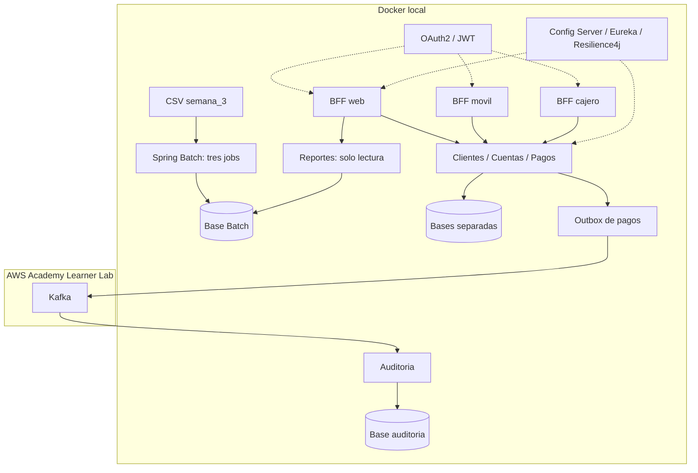

# EFT S9 — Desarrollo Backend III

Alberto Agustín García · Duoc UC

Modernización de procesos financieros con Spring Batch, microservicios de clientes, cuentas y pagos, BFF web/móvil/cajero, OAuth2 y Kafka.

Repositorio: [AgustinG1/fin-legacy-eft-s9](https://github.com/AgustinG1/fin-legacy-eft-s9). Los nueve CSV originales provienen de [KariVillagran/fin_legacy_data](https://github.com/KariVillagran/fin_legacy_data) y se conservan sin modificaciones. La demostración utiliza los tres archivos de `data/semana_3`.

## Ejecución

Con Docker Desktop abierto, ejecutar desde la raíz del proyecto:

```powershell
powershell -NoProfile -ExecutionPolicy Bypass -File scripts/iniciar-reportes.ps1
powershell -NoProfile -ExecutionPolicy Bypass -File scripts/verificar-reportes.ps1
```

El primer script construye los servicios, genera credenciales locales, inicia la infraestructura y ejecuta los tres jobs Batch. Las instrucciones completas, pruebas y apagado están en [instrucciones.md](instrucciones.md).

## Arquitectura



Solo Kafka se despliega en AWS, según la aclaración docente. Los demás componentes funcionan localmente. [despliegue.md](despliegue.md) contiene el procedimiento manual. El despliegue remoto queda pendiente de ejecución y validación; las pruebas locales no lo acreditan.

## Requisitos y decisiones

| Requisito | Implementación |
|---|---|
| Integridad y trazabilidad de la migración | Transacciones por bloque, archivo/fila de origen, rechazos y control de duplicados; conciliación de todas las entradas. |
| Procesamiento concurrente reproducible | Rangos estables de 250 filas, hasta tres trabajadores y checkpoints; comparación secuencial/paralela. |
| Acceso y respuestas por canal | Tres BFF con contratos diferentes, JWT, audiencias, scopes y comprobación de propiedad de cuentas. |
| Recuperación de fallos temporales | Reintentos y reinicio limitado en Batch; circuit breaker y retry en consultas; pagos idempotentes, outbox y consumidor con deduplicación. |

Los BFF llaman al backend y no acceden directamente a las bases de datos. Reportes permite consultar la migración desde el BFF web administrativo. Kafka usa entrega al menos una vez y un tópico DLT para mensajes inválidos.

## Resultados de semana 3

| Proceso | Entradas | Válidos únicos | Rechazados | Duplicados válidos |
|---|---:|---:|---:|---:|
| Movimientos diarios | 1000 | 392 | 608 | 0 |
| Intereses | 1000 | 421 | 578 | 1 |
| Estados anuales | 1000 | 304 | 696 | 0 |
| Total | 3000 | 1117 | 1882 | 1 |

Validación local: 60 pruebas Maven aprobadas, 35 comprobaciones de reportes/API/BFF y equivalencia de 14 CSV entre H2/PostgreSQL y uno/tres trabajadores. Los scripts generan los resultados de cada ejecución localmente.

## Organización

- `batch/`: jobs, validación, persistencia, reportes y pruebas.
- `servicios/`: microservicios, BFF, OAuth2, Config Server, Eureka y pruebas.
- `data/`: archivos de la docente.
- `scripts/`: inicio, comprobación, medición y conexión a Kafka remoto.
- `infra/aws/iniciar-kafka.sh`: instalación de Kafka en una instancia del laboratorio.
- `compose*.yaml`: configuración Docker local y conexión al broker remoto.

## Alcance de la demostración

La tasa `0.05` y el período `TRIMESTRAL-DEMO` son valores configurables de prueba; no constituyen una regla confirmada por el docente. Las identidades de canal son sintéticas y utilizan `client_credentials`, sin inicio de sesión interactivo de personas. Los datos históricos se consultan por reportes: los CSV no permiten relacionar de forma fiable todos sus identificadores con cuentas operativas. El repositorio base no contiene programas COBOL ejecutables; la equivalencia se verifica mediante reglas, fixtures e invariantes, no mediante una ejecución del sistema legacy original.
